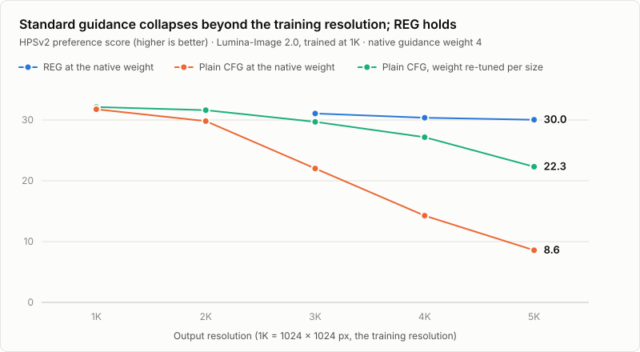
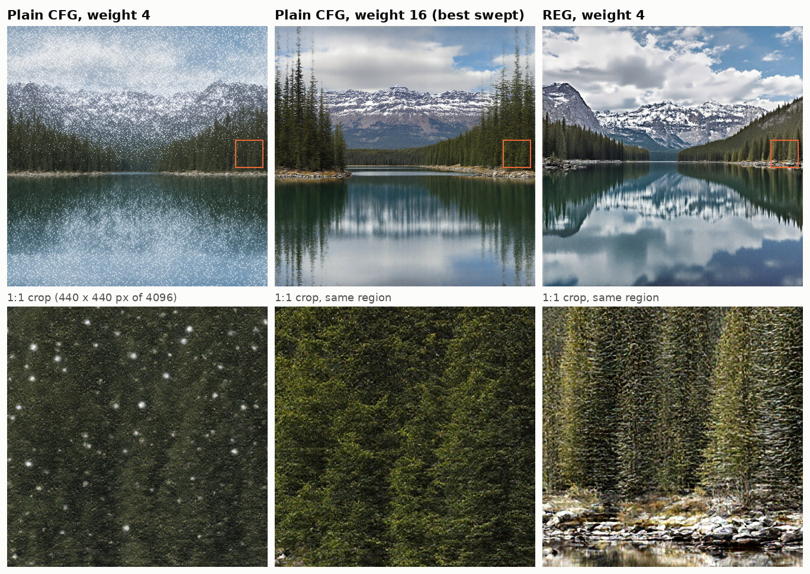

# Resolution-Equivariant Guidance (REG)

**A training-free method that lets text-to-image diffusion transformers generate at 3 to 5 times their training resolution without re-tuning guidance.**

Research in progress (started October 2026), aimed at an ICML 2027 submission. Every number below comes from experiments recorded in this repository.

<picture>
  <source media="(prefers-color-scheme: dark)" srcset="assets/quality_vs_resolution_dark.svg">
  
</picture>



*One example from the 4K Lumina-Image 2.0 grid (prompt "A serene lake reflected in still water, surrounded by snow-capped mountains and evergreen forests under a partly cloudy sky", seed 24; chosen because its REG-versus-best-plain gap is the median of the 50 prompts, not the largest). Top: full images downscaled. Bottom: the same 440 × 440 pixel region of each image at 1:1, marked by the orange box.*

## The project in five points

- **Problem.** Image models such as Lumina-Image 2.0 and Qwen-Image are trained at about 1K. Recent methods (DyPE and others) adjust the positional encoding so the same model can generate 2K to 4K images, but they leave *guidance* at its training-resolution setting. Guidance (classifier-free guidance, CFG) is the control that decides how strongly the image follows the prompt.
- **Finding.** That setting stops working as resolution grows. In an 11,800-image sweep from 1K to 4K, image quality at the standard guidance weight falls steadily, and at 5K the subject is missing from 60 % of single-subject images. Raising the weight fourfold recovers only part of the loss.
- **Diagnosis.** The error sits in the coarse, layout-level part of the model's prediction, and it is the same in the prompted and unprompted branches. Guidance amplifies the difference between those branches, so it cannot remove an error they share.
- **Method.** REG takes that coarse part from a cheap extra pass at the training resolution, where the model is reliable, and keeps the fine detail from the full-resolution pass. No training, and nothing tuned per resolution.
- **Result.** With the unchanged training-resolution weight, REG holds 30 to 31 HPSv2 from 3K to 5K on Lumina-Image 2.0, above the best re-tuned baseline at every size, for 2 to 14 % more compute and no extra memory.

## Results

HPSv2.1 (a learned predictor of human preference, ×100, higher is better) on the same prompts and seeds for every method in a row. "Best weight" is the best plain-CFG setting in the weight sweep at that size, which was 16 in every row; REG always uses the training-resolution weight, 4.

| Model | Output size | Prompts | Plain CFG, weight 4 | Plain CFG, best weight (16) | **REG, weight 4** | REG minus best plain, paired [95 % CI] |
|---|---|---|---|---|---|---|
| Lumina-Image 2.0 | 3K | 100 | 22.0 | 29.7 | **31.1** | +1.4 [1.0, 1.8] |
| Lumina-Image 2.0 | 4K | 50 | 14.3 | 27.2 | **30.4** | +3.2 [2.5, 3.9] |
| Lumina-Image 2.0 | 5K | 50 | 8.6 | 22.3 | **30.0** | +7.7 [6.3, 9.2] |
| Qwen-Image | 3K | 50 | 24.7 | 26.7 | **29.2** | +2.5 [1.6, 3.5] |
| Qwen-Image | 4K ‡ | 50 | 24.7 | 28.3 | **29.0** | +0.7 [−0.0, 1.4], not significant |

‡ With Qwen's timestep shift capped at its 3K value for every method. Under the stock schedule the margin is +1.7 [0.8, 2.5]; part of that was REG tolerating a poor schedule better than the baseline, so the fair comparison is the one in the table. On this cell REG also leads on ImageReward (+0.25 [0.09, 0.41]) and has no duplicated subjects against 4 % for the baseline.

What the table supports:

- At the training-resolution weight REG is far ahead of plain CFG on both models (+4.2 to +21 HPSv2).
- Against a baseline whose weight was re-tuned for each resolution, REG is ahead on four of five cells and level on the fifth, without any tuning.
- The other metrics agree: ImageReward, CLIP score, patch-KID and an object-detector count of missing or duplicated subjects. Full tables are in [08-phase1-pilot.md](08-phase1-pilot.md) and the CSVs in [results/](results/).
- On Lumina at 4K, REG scores the same under two positional-encoding extrapolation schemes (dynamic NTK and YaRN).
- Cost on Lumina-Image 2.0: +2 % time per image at 3K and +14 % at 4K, with the same peak memory. A 6K (6144 × 6144) image fits on one 32 GB GPU.

## How REG works

Let *r* be the ratio of output size to training size and σ the current noise level. At each denoising step:

1. **Native anchor.** Average-pool the noisy latent by *r*. Pooling averages *r*² noise samples, so the result is a valid training-resolution sample at a lower noise level that is known exactly:

   ```math
   \sigma' = \frac{\sigma / r}{(1 - \sigma) + \sigma / r}
   ```

   The model is run on that sample (1/*r*² of the tokens, so it is cheap), and the band of frequencies a training-resolution image can represent is taken from this pass, for both the base prediction and the guidance difference.
2. **Octave pyramid.** Further passes at half the output size, a quarter, and so on, are added while they are still at least twice the training size. Each supplies the band between its own limit and the next coarser one.
3. **Super-native band.** Frequencies above the training-resolution limit, which the model never saw in training, get three times the guidance weight.

The guidance weight is the one the model already uses at its training resolution. At *r* = 1 the method reduces to plain CFG bit for bit. The single-anchor case is equivalent to Upsample Guidance ([arXiv:2404.01709](https://arxiv.org/abs/2404.01709)) in flow-matching form; this project contributes the diagnosis, the pyramid, the super-native term, and the evaluation on transformers with rotary position encoding. The implementation is about 150 lines: [reg/guidance/anchor.py](reg/guidance/anchor.py).

## What is in the repository

About 5,600 lines of Python in 70 files, 43 unit tests, and the full experiment record.

- **Samplers verified against the reference pipelines.** Lumina-Image 2.0 and Qwen-Image run through this project's own denoising loop, which is checked to be bit-identical to the stock `diffusers` pipelines. Reaching that for Qwen-Image meant finding two numerical discrepancies: the order of a timestep cast, and an all-ones attention mask that selects a different attention kernel.
- **One guidance abstraction.** CFG, CFG intervals, frequency-decoupled guidance, PAG, SEG, TPG and the REG anchor are composable terms on one `Guidance` class ([reg/guidance/](reg/guidance/)).
- **DyPE reimplemented** from the paper and the authors' code, reproduced on FLUX, then ported to Lumina and Qwen ([reg/extrap/dype.py](reg/extrap/dype.py), [07-dype-reference.md](07-dype-reference.md)).
- **Memory work for 32 GB cards.** FP8 weight-only quantization for FLUX.1-dev and Qwen-Image, two-phase loading with a text-embedding cache, and tiled VAE decoding ([reg/models/](reg/models/)).
- **Evaluation stack.** CLIP score, patch FID/KID, HPSv2, ImageReward, an OWL-ViT subject counter and a speckle statistic, with paired bootstrap confidence intervals ([reg/eval/](reg/eval/), [scripts/run_eval.py](scripts/run_eval.py), [scripts/run_pref.py](scripts/run_pref.py), [scripts/reg_paired.py](scripts/reg_paired.py)).
- **Distributed job runner.** JSONL job files split across five single-GPU servers, safe to resume, with a free-memory guard for shared machines ([scripts/run_grid.py](scripts/run_grid.py), [SERVER_SETUP.md](SERVER_SETUP.md)).

## How the research was run

The project follows a written plan with go/no-go gates ([PLAN.md](PLAN.md)). Each hypothesis was recorded together with the experiment that would test it, and the ones that failed are kept in the record:

- Matching the size of the guidance signal per frequency band, the original hypothesis, was refuted by direct measurement.
- Anchoring only the guidance difference, not the base prediction, fails at 4K.
- Switching guidance off above the training-resolution limit makes images worse; the correct sign is more guidance there.
- Perturbation guidance (PAG, SEG, TPG) does not carry over to high resolution, and no rescaling of it recovers the gain it gives at 1K.
- On Qwen-Image at 4K, REG matches the re-tuned baseline but does not beat it once both use the same schedule. It is reported that way.

The day-by-day log is in [STATUS.md](STATUS.md).

## Repository map

| Path | Contents |
|---|---|
| [reg/](reg/) | Python package: `models/`, `guidance/`, `extrap/`, `eval/`, `diag/` |
| [scripts/](scripts/) | Sampling, the grid runner, scoring, figures, cluster utilities |
| [jobs/](jobs/) | Every experiment as a JSONL job file, one image per row |
| [results/](results/) | Scored results as CSV (generated images are kept off git) |
| [tests/](tests/) | Unit tests; the GPU tests skip without CUDA |
| [03](03-literature-review.md), [04](04-novelty-check.md) | Literature review and novelty check |
| [05](05-method-and-contributions.md) | Method and contributions, with every revision dated |
| [06](06-compute-and-datasets.md), [07](07-dype-reference.md), [08](08-phase1-pilot.md) | Compute and datasets, the DyPE reference, all experiment results |

## Running it

Requires Linux, Python 3.12 or later, and a CUDA GPU. Measured peak memory for Lumina-Image 2.0 is 12 GB at 1K, 17 GB at 4K and 27 GB at 6K; Qwen-Image needs 20 GB or more.

```bash
bash scripts/setup_env.sh                  # virtual environment from requirements.lock
export REG_DATA=/path/for/weights_and_outputs
source env.sh
python -m pytest tests                     # GPU tests skip without CUDA

# one image with plain CFG
python scripts/sample.py --prompt "a red fox in snow" --size 1024

# an experiment file on a single machine; REG rows carry an "anchor" entry
python scripts/run_grid.py --jobs jobs/reg_5k_grid.jsonl --out $REG_DATA/outputs/reg_5k_grid \
    --server-id 0 --num-servers 1
```

A REG job row at 4K looks like this:

```json
{"model": "lumina", "prompt": "...", "height": 4096, "width": 4096, "extrap": "ntk", "guidance": 4.0,
 "anchor": {"scale": 4.0, "ratio": 4, "base": true, "levels": [2], "super_scale": 12.0}}
```

The chart at the top is rebuilt from the committed CSVs by `python scripts/readme_figure.py`.

## Status and limitations

- Work in progress: there is no paper yet, and the method may still change.
- Evaluated on two models so far. FLUX.1-dev, whose guidance is distilled into the model, has a loader and a DyPE reproduction but no REG results.
- Quality is measured with learned preference and alignment scorers and by inspection; there is no human study.
- Comparisons so far are against plain CFG at swept weights. A DrawBench run at 4K (prompt adherence, 200 prompts) and a generate-at-1K-then-upscale baseline are in progress.

## Author

Pourya Moghadam · [github.com/Pourya-Moghadam](https://github.com/Pourya-Moghadam)
